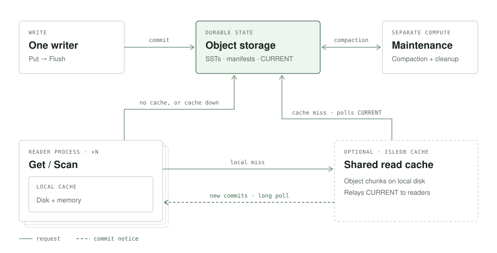

# IsleDB


[](https://github.com/ankur-anand/isledb/actions/workflows/go.yml)
[](https://coveralls.io/github/ankur-anand/isledb?branch=main)
[](https://pkg.go.dev/github.com/ankur-anand/isledb)
[](LICENSE)

**A key-value database for object storage, written in Go.**

Store durable key-value data on Amazon S3, Google Cloud Storage, Azure Blob
Storage, or any S3-compatible store such as MinIO; local files and memory work
for development. Add reader services independently and run compaction outside
your application processes.

IsleDB provides:

- point reads, range scans, iterators, snapshots, TTLs, and deletes;
- one fenced writer with any number of independent reader processes, usable
  from any language through an optional HTTP write service (`isledb writer`);
- configurable local caching for readers, and an optional shared read cache
  per region (`isledb cache`);
- optional keys-only or full-value change feeds;
- compaction and storage cleanup that can run in a separate process or
  scheduled job.

<picture>
  <source media="(prefers-color-scheme: dark)" srcset="docs/architecture-dark.svg">
  
</picture>

Use IsleDB as a Go library, or run it as services that any language reaches
over HTTP:

**[Use it as a Go library](#use-it-as-a-go-library) · [Run it as services](#run-it-as-services)**

## When IsleDB fits

IsleDB is a good fit when:

- object storage is the durability and capacity layer;
- writes can be buffered and published in batches;
- readers should scale without maintaining database replicas;
- second-scale freshness is acceptable;
- compaction should run away from application servers.

Choose a different database when you need:

- consistent sub-10-millisecond read-after-write latency;
- multi-key transactions or compare-and-swap updates;
- secondary indexes, joins, or a query language;
- high-frequency updates to a small, hot dataset.

## Use it as a Go library

### Install

```bash
go get github.com/ankur-anand/isledb
```

IsleDB requires Go 1.25 or newer.

### Quick start

This example uses an Amazon S3 bucket; credentials come from the standard AWS
environment (`AWS_PROFILE`, `AWS_ACCESS_KEY_ID`, an instance role, and so on).
`Put` buffers the mutation and `Flush` makes it durable and visible to readers
that refresh.

```go
package main

import (
	"context"
	"fmt"
	"log"
	"path/filepath"

	"github.com/ankur-anand/isledb"
)

func main() {
	if err := run(context.Background()); err != nil {
		log.Fatal(err)
	}
}

func run(ctx context.Context) error {
	db, err := isledb.Open(ctx, "s3://my-bucket?region=us-east-1", isledb.DBOptions{
		Prefix: "example",
	})
	if err != nil {
		return err
	}
	defer func() { _ = db.Close() }()

	writerOptions := isledb.DefaultWriterOptions()
	// Commit only on Flush, for this example; by default the writer also
	// commits every second.
	writerOptions.Flush.Interval = 0

	writer, err := db.OpenWriter(ctx, writerOptions)
	if err != nil {
		return err
	}
	if _, err := writer.Put(ctx, []byte("hello"), []byte("world")); err != nil {
		return err
	}
	if err := writer.Flush(ctx); err != nil {
		return err
	}
	if err := writer.Close(ctx); err != nil {
		return err
	}

	cacheDir, err := filepath.Abs("./isledb-cache")
	if err != nil {
		return err
	}
	reader, err := db.OpenReader(
		ctx,
		isledb.DefaultReaderOpenOptions(cacheDir),
	)
	if err != nil {
		return err
	}
	defer func() { _ = reader.Close() }()

	value, found, err := reader.Get(ctx, []byte("hello"))
	if err != nil {
		return err
	}
	if found {
		fmt.Printf("hello = %s\n", value)
	}
	return nil
}
```

The same API works with cloud bucket URLs:

| Provider | Example bucket URL |
| --- | --- |
| Amazon S3 | `s3://my-bucket?region=us-east-1` |
| Google Cloud Storage | `gs://my-bucket` |
| Azure Blob Storage | `azblob://my-container` |

Credentials and provider-specific options come from the corresponding
[Go Cloud bucket driver](https://gocloud.dev/howto/blob/). Use a unique prefix
for each database.

> **Local stores are for development only.** `file://` and `mem://` buckets
> behave correctly within one process, which is enough for local experiments
> and tests. Across processes, their conditional writes are not atomic, so
> never point two processes at the same `file://` directory, and do not use
> them in production. Use S3, Google Cloud Storage, Azure Blob Storage, or an
> S3-compatible store.

### Behavior to know

- `Put`, `PutWithTTL`, and `Delete` buffer mutations in memory and return
  each mutation's sequence. `WaitCommitted(ctx, seq)` returns once that write
  is in object storage; use it before acting on a write you cannot lose.
- If storage is down, writes wait in memory and are retried; once
  `MaxPendingMemtables` memtables are waiting, `Put` returns `ErrBackpressure`.
- A successful `Flush`, background flush, or `Writer.Close` is the durability
  and visibility boundary. `Flush` can be retried; `Close` makes one attempt
  and finishes the writer either way, reporting any writes not known to be
  committed. To stop gracefully, call `Drain`, then `Close` with a deadline,
  then `DB.Close`; see [Shutting down](#shutting-down).
- One writer owns a database prefix at a time. Writer ownership is fenced across
  processes.
- A reader uses a consistent loaded view. It refreshes according to its view
  policy; call `Refresh` when a newly committed write must be discovered
  immediately.
- `Writer.State` reports whether the writer is open, stopped, closed or
  fenced, and how much is not yet committed, for readiness probes and
  dashboards.
- Reader services scale independently by opening the same bucket and prefix with
  their own local cache directories.
- Run maintenance in production so compaction, checkpoints, configured
  retention, and physical cleanup continue to make progress.

#### Shutting down

`Drain` stops intake and commits everything accepted, retrying until its
context ends; `Close` is the final step:

```go
if err := writer.Drain(ctx); err != nil { // Put and Delete now return ErrWritesStopped
    log.Printf("drain: %v", err)
}
closeCtx, cancel := context.WithTimeout(context.Background(), 2*time.Minute)
defer cancel()
if err := writer.Close(closeCtx); err != nil {
    log.Printf("writer closed with unconfirmed writes: %v", err) // the error names them
}
_ = db.Close()
```

`DB.Close` alone closes an open writer with a fixed 30-second deadline and no
retry; it is cleanup, not the durability step. Set `Flush.Interval` so a
crash loses at most one interval of writes.

See the [Go API guide](api.md) for scans, iterators, snapshots, prefetching,
configuration, metrics, and error handling.

### Change feed

Enable the change feed when another service needs committed mutations in writer
order:

```go
db, err := isledb.Open(ctx, bucketURL, isledb.DBOptions{
	Prefix: "prod/accounts",
	ChangeFeed: &isledb.ChangeFeedOptions{
		Payload: isledb.ChangeFeedFullValues,
	},
})
```

Use `ChangeFeedKeysOnly` for invalidation or downstream re-fetching. Use
`ChangeFeedFullValues` when consumers need the committed PUT values. The mode
is persisted when the feed is enabled and cannot later be changed for that
database prefix.

Consumers use `OpenChangeReader` with an opaque, persistent cursor. See
[Change feed](api.md#change-feed)
for the complete example and retention behavior.

### Maintenance

Maintenance can run continuously in its own service or periodically as a job.
It opens the same database prefix as the writer and readers.

```go
func runMaintenance(ctx context.Context, bucketURL string) error {
	db, err := isledb.Open(ctx, bucketURL, isledb.DBOptions{
		Prefix: "prod/accounts",
	})
	if err != nil {
		return err
	}
	defer func() { _ = db.Close() }()

	maintenance, err := db.OpenMaintenance(ctx, isledb.DefaultMaintenanceOptions())
	if err != nil {
		return err
	}
	defer func() { _ = maintenance.Close(context.Background()) }()

	return maintenance.Run(ctx) // until ctx ends or another process takes over maintenance
}
```

The active writer publishes maintenance results, while cleanup proceeds at its
own bounded pace. Use `RunOnce` instead of `Run` for a scheduled job.

To run it without writing code, see the
[maintenance service](#maintenance-service).

### Reading through the shared cache

With an [`isledb cache`](#shared-read-cache) in the region, point readers and
change-feed consumers at it:

```go
opts := isledb.DefaultReaderOpenOptions(cacheDir)
opts.ReadCache = isledb.ReadCacheOptions{
	URL:   "http://isledb-cache:8090",
	Token: token,
}
reader, err := db.OpenReader(ctx, opts)

feed, err := db.OpenChangeReader(ctx, isledb.ChangeReaderOptions{
	ReadCache: isledb.ReadCacheOptions{URL: "http://isledb-cache:8090", Token: token},
})
```

## Run it as services

One binary runs each service:

```bash
go install github.com/ankur-anand/isledb/cmd/isledb@latest
```

| Service | Does | Listens on | Run |
| --- | --- | --- | --- |
| `isledb writer` | Takes writes over HTTP | `:8070` | One per database |
| `isledb reader` | Serves reads and scans over HTTP | `:8080` | As many as you need |
| `isledb maintenance` | Compacts and cleans up; no API | admin only, `127.0.0.1:8061` | One per database |
| `isledb cache` | Optional regional read cache | `:8090` | One or more per region |

Each also serves health checks and metrics on its admin address. Run
`isledb help` for the list, and `isledb <service> -h` for a service's flags.

### Writer service

`isledb writer` holds the writer for one database and serves writes over
HTTP, so services in any language can write:

```bash
isledb writer \
  --bucket-url 's3://my-bucket?region=us-east-1' \
  --prefix prod/accounts \
  --auth-token-file /etc/isledb/tokens
```

```bash
curl -X PUT -H "Authorization: Bearer $TOKEN" \
  --data '{"name":"a"}' 'http://isledb-writer:8070/v1/kv/user/42?ttl=24h'
# {"write_id":"1.1","revision":"2"}
```

A write is answered once it is durable in object storage; batches of puts and
deletes go to `POST /v1/kv` and apply atomically. Run one writer per
database. See [Running `isledb writer`](docs/isledb-writer.md) and the
[writer HTTP API](docs/writer-api.md).

### Reader service

`isledb reader` serves reads over HTTP. Replicas share nothing, so you scale
reads by adding them behind a load balancer:

```bash
isledb reader \
  --bucket-url 's3://my-bucket?region=us-east-1' \
  --prefix prod/accounts \
  --cache-dir /var/cache/isledb \
  --auth-token-file /etc/isledb/tokens
```

```bash
curl -H "Authorization: Bearer $TOKEN" 'http://isledb-reader:8080/v1/kv/user/42'
# {"name":"a"}
curl -H "Authorization: Bearer $TOKEN" 'http://isledb-reader:8080/v1/kv?prefix=user/'
# {"items":[{"key":"user/42","value":"{\"name\":\"a\"}"}]}
```

If the database has a change feed, readers also serve it at
`/v1/changes?from=…`, so consumers in any language can follow it.

The paths match the writer's, so one gateway can route `GET` to readers and
writes to the writer. A read is usually within a second of the writer (about
two on Google Cloud Storage), and its `Isledb-Revision` header says which
writes it includes. See
[Running `isledb reader`](docs/isledb-reader.md) and the
[reader HTTP API](docs/reader-api.md).

### Maintenance service

`isledb maintenance` compacts the database, keeps its metadata short and
deletes what is no longer needed. It has no API. Run exactly one per
database, alongside the writer:

```bash
isledb maintenance \
  --bucket-url 's3://my-bucket?region=us-east-1' \
  --prefix prod/accounts \
  --scratch-dir /var/lib/isledb/scratch
```

A second one for the same database takes over, and the first stops working
and reports not ready. See
[Running `isledb maintenance`](docs/isledb-maintenance.md).

### Shared read cache

`isledb cache` is an optional service that sits between readers and object
storage, typically one per region. It serves immutable objects (SSTs,
manifest pages, change batches) from chunks on its local disk, and relays
`CURRENT` so readers learn of new commits through a long poll instead of
polling storage.

Run it next to the readers:

```bash
isledb cache \
  --bucket-url 's3://my-bucket?region=us-east-1' \
  --db prod/accounts \
  --disk-dir /var/cache/isledb --disk-bytes 200GiB \
  --auth-token-file /etc/isledb/tokens
```

The cache only makes reads faster and cheaper; it never decides what readers
see. Readers check what it returns against checksums, reject a copy of
`CURRENT` that is too old, and read storage directly whenever the cache is
slow, down, or wrong.
See [Running `isledb cache`](docs/isledb-cache.md) and the
[read cache HTTP API](docs/read-cache-api.md).

An `isledb reader` uses it through `read_cache.url`; a Go program, through
[`ReadCacheOptions`](#reading-through-the-shared-cache).

## Versions and support

IsleDB is before 1.0. A minor release, such as 0.19 to 0.20, may change the
Go API, the services' flags and configuration, the HTTP API, or metrics; its
release notes say what changed and how to move to it. A patch release, such
as 0.19.0 to 0.19.1, only fixes problems.

Fixes go into the next release; earlier releases are not patched. Run a
recent release, and name its exact version wherever you deploy it.

## Documentation

Library:

- [Go API guide](api.md)
- [Go package reference](https://pkg.go.dev/github.com/ankur-anand/isledb)
- [Local quickstart](examples/quickstart)
- [Separate writer, reader, and maintenance services with MinIO](examples/minio-services)
- [Restartable change-feed consumer with Azurite](examples/changefeed-azurite)

Services:

- [Running the writer service](docs/isledb-writer.md) and its [HTTP API](docs/writer-api.md)
- [Running the reader service](docs/isledb-reader.md) and its [HTTP API](docs/reader-api.md)
- [Running the maintenance service](docs/isledb-maintenance.md)
- [Running the shared read cache](docs/isledb-cache.md) and its [HTTP API](docs/read-cache-api.md)

Storage:

- [Choosing and setting up object storage](docs/object-store-guide.md)
- [Object-store layout and operations](docs/object-store-schema.md)

## Acknowledgments

IsleDB uses the SSTable implementation from
[Pebble](https://github.com/cockroachdb/pebble). Thanks to the CockroachDB team
for building and open-sourcing it.

## License

IsleDB is licensed under the [Apache License 2.0](LICENSE).
