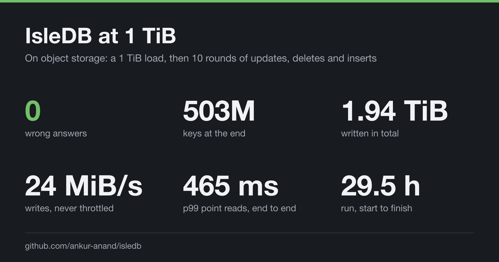
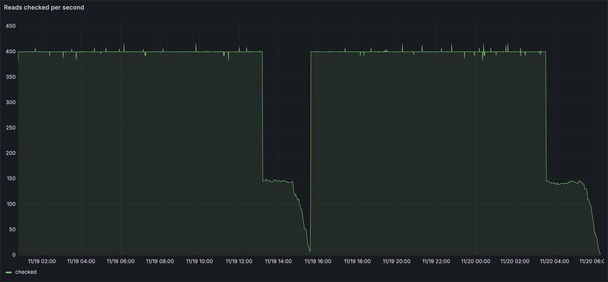
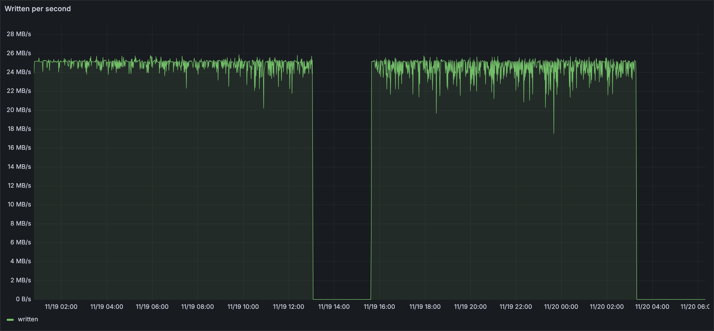
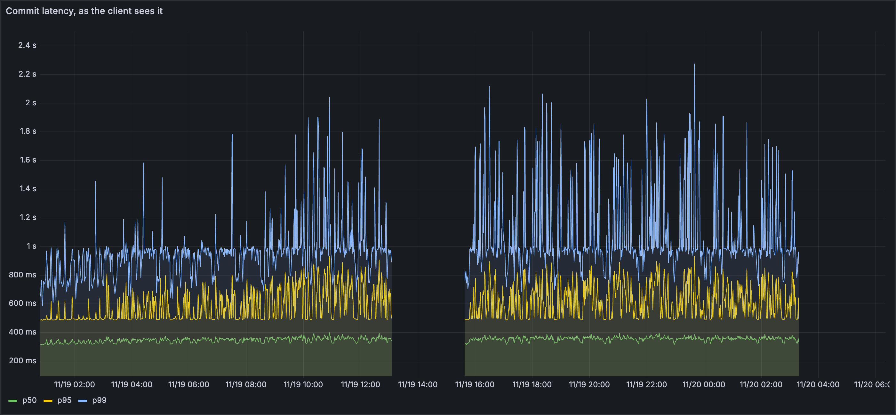
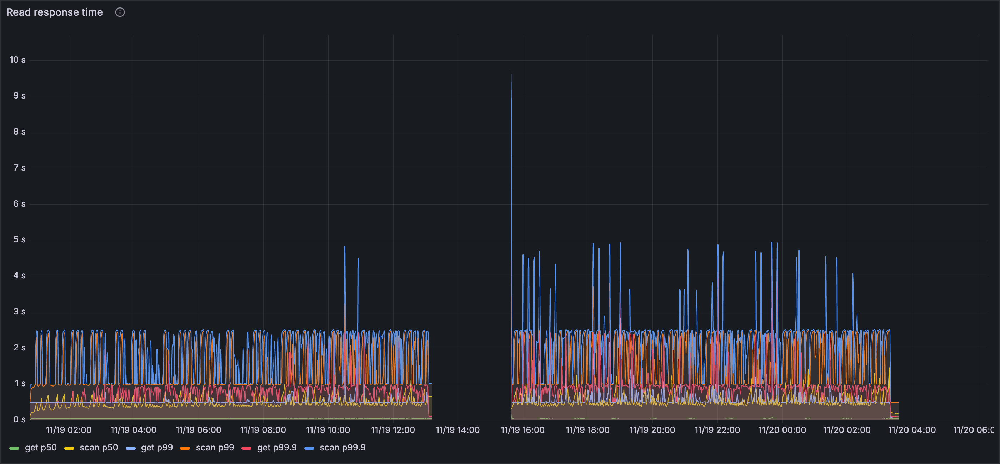
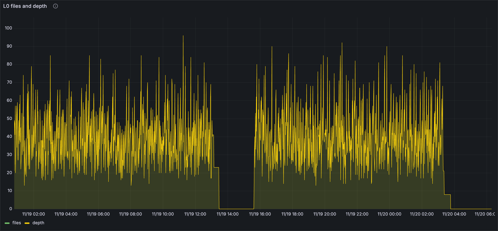
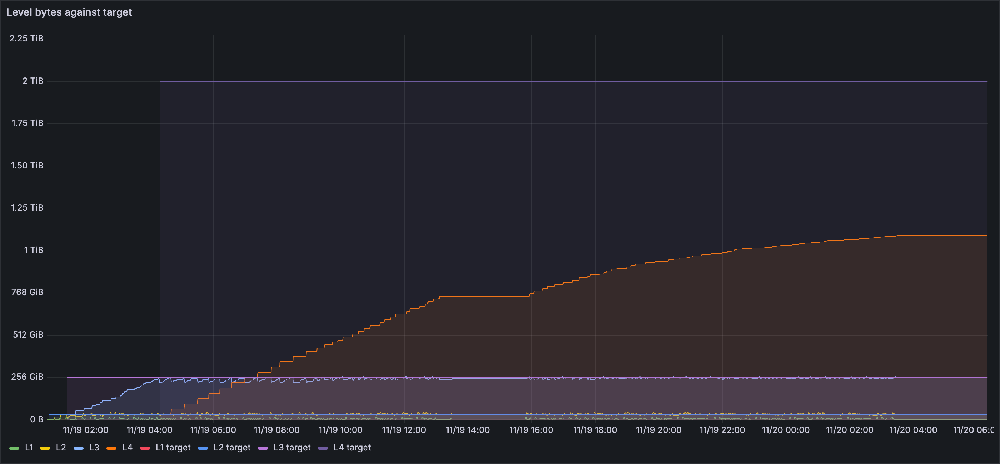
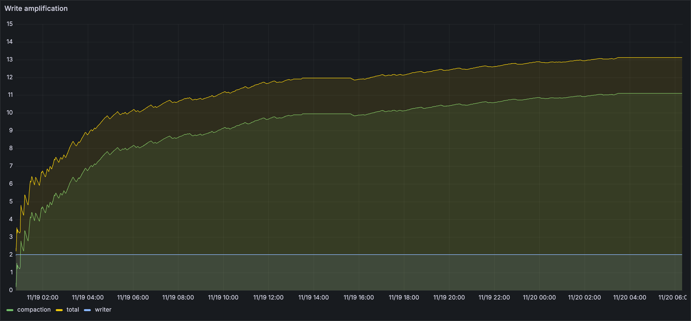
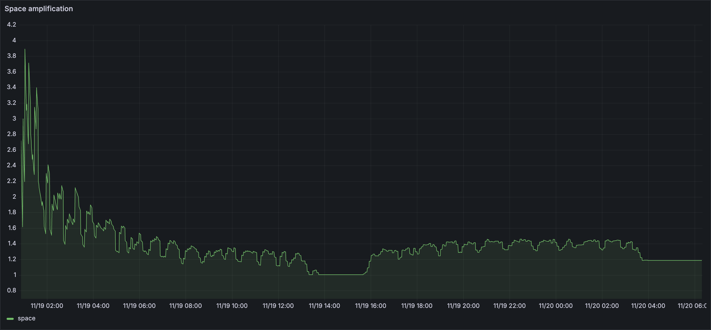
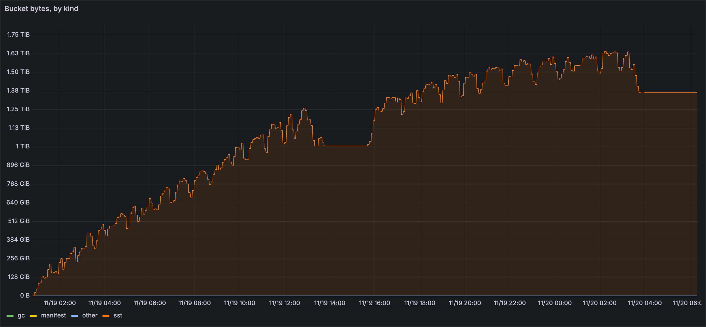

# IsleDB at 1 TiB: nearly 2 TiB of writes, 503 million keys, zero wrong answers



IsleDB is an LSM-tree database that keeps all of its data in object storage.
We wanted to see how it holds up with a big dataset and a write load that
never lets up, so we gave it one: load 1 TiB, then spend another 12 hours
updating, deleting and inserting, with readers hitting it the whole time. The
whole thing took 29.5 hours.

We checked every read. None came back wrong, and no write went missing. Writes
ran at 24 MiB/s from the first minute to the last, and compaction never fell
behind.

## The numbers

| | |
|---|---|
| Data written | ~1.94 TiB (1 TiB load plus 10 update rounds) |
| Keys after the load | 437,860,913 |
| Keys at the end | 503,227,810 |
| Wrong answers | 0 |
| Lost, refused or unresolved writes | 0 |
| Full-keyspace verification scans | 2, both passed |
| Write rate | 24 MiB/s, never throttled |
| Reads during load and updates | 400/s, none dropped |
| Point read p99, end to end | 465 ms |
| Commit p50 / p99 | 314 ms / 688 ms |
| Space amplification | 1.19× |
| Write amplification | 13.1× |
| Total run time | 29.5 hours |

> **Reading the graphs.** Each one covers the whole run: the first busy
> stretch is the load, the second is the updates, and the quiet parts are the
> settle and verify phases. Latency graphs show percentiles per minute, so a
> one-minute spike to 2 s doesn't contradict a whole-run p99 of 688 ms.

## Correctness

Every read was checked against the exact revision it should see. A stale
value, a deleted key that comes back, or a key that has gone missing all
count as wrong answers, and there were none. After the load and again at the
end, we also read back every key and compared it with a separate record of
what should be there. Both scans passed.



*Reads checked per second: a steady 400 while writes run, lower during the
verification scans.*

## Writes

Writes held 24 MiB/s through the load and the updates, and the writer never
had to push back on clients. Commit latency was 314 ms at p50 and 688 ms at
p99, which needs some context: it means something different here from commit
latency on a database with a local disk.

**What we measured.** The time from a client sending a batch of 16 writes to
the writer until the writer tells it the batch is committed. Committed means
the batch is saved in object storage and will survive the writer crashing. It
does not mean a reader already sees it. Readers don't hear about commits; each
one checks object storage for the newest state of the database on its own
timer, once a second by default (`refresh_after`), and that's what this run
used. So a committed write shows up in reads within about a second.

**Where the time goes.** The writer doesn't save each batch on its own. It
collects everything that arrives and saves it as one group every 250 ms, the
default flush interval. So a batch first waits for the next flush, anywhere
from 0 to 250 ms, and then for its group to be saved, which took about 100 ms
at p50 and 155 ms at p99 in this run. Saving a group is two requests to
object storage, each with the 15 to 40 ms of added latency.

**What it doesn't limit.** Throughput. The writer keeps taking new batches
while a group is being saved, so many batches are in flight at once. That's
how 256 clients held 24 MiB/s even though each one waited about a third of a
second per batch.

**How to change it.** A shorter flush interval cuts the waiting part, at the
cost of more requests to storage, since every group costs two requests
however many writes it holds. A longer one does the opposite.



*Bytes written per second, flat at 24 MiB/s.*



*Commit latency per minute, with the median steady around 300 ms.*

## Reads

Measured end to end at p99, including any time a read spent waiting in line:

| Read | p99 |
|---|---|
| Point read, anywhere in the keyspace | 465 ms |
| Point read, recently written key | 447 ms |
| Scan of 1 to 100 keys | 1.5 s |

A read that misses the cache has to go to object storage, at 15 to 40 ms a
request, and a scan usually touches several files, which is where most of
that time goes. There were no read errors and no retries.

No reads were dropped while writes were running.



*Read response time per minute, from the median up to p99.9. About as fast at
503 million keys as near the start.*

## Compaction

L0 hovered around 40 files deep for the whole run and peaked at about 100.
Compaction kicks in at 32, so it was keeping up with a bit of overshoot
rather than falling further and further behind. It hit critical pressure in
fewer than 1% of samples. Maintenance runs up to two compaction jobs at once,
each on its own levels.



*L0 depth, the files a read may have to check: the same band all run, and zero
once writes stop.*



*Each level against its target: L3 holds at 256 GiB and L4 grows to about
1.1 TiB.*

## Space, write amplification and cost

Space amplification ended at 1.19×. That's with replaced files kept for 10
minutes before they're deleted; the default is an hour, which would hold more
space for longer.

Write amplification ended at 13.1×, meaning bytes written to object storage
for each byte the application wrote. About 2× of that comes from the writer
and the rest from compaction. Random keys push it up; an ordered workload
would come in lower.

The run made 93.2 million requests to object storage, which comes to about
$46 at S3 request prices for all 29.5 hours. That's requests only; storing the
data is extra.



*Write amplification, climbing as the tree gets deeper, then flat.*



*Space amplification, jumpy while the dataset is tiny, then near 1.2×.*



*Everything in the bucket: it grows with the data and drops back once replaced
files are deleted.*

## What we ran

Keys are 16 bytes and land in random order across the keyspace. That's the
worst case for an LSM tree, since every new file overlaps pretty much
everything below it and compaction has to rewrite a lot. Values range from
100 bytes to 16 KiB: half are under 512 B, about a third go up to 4 KiB, and
the rest up to 16 KiB, for an average around 2.5 KB.

1. **Load, 12.3 hours.** Insert 1 TiB at a steady 24 MiB/s.
2. **Settle and verify.** Let compaction finish, then read back every key.
3. **Update, 11.7 hours.** Ten rounds. Each one rewrites 5% of the keys, with
   30% of those aimed at the hottest tenth of the keyspace. A tenth of each
   round's writes are deletes, and each round also adds 2% new keys.
4. **Settle and verify again,** this time over all 503 million keys.

While writes were running, readers sent 300 reads a second spread across the
whole keyspace (one in ten of them a scan of 1 to 100 keys) and another 100 a
second for keys written recently.

There was one writer, one reader and one maintenance process. Storage was an
S3-compatible server with 15 to 40 ms of latency added to every request, so
each request costs roughly what it would against a real object store.

<details>
<summary><b>Settings we changed</b></summary>

We changed a few settings for the heavy write load and left the rest alone.

| Setting | This run | Default |
|---|---|---|
| `l0_max_depth` | 32 | 16 |
| `l0_to_base_ratio` | 4 | 1 |
| `base_level_bytes` | 4 GiB | 512 MiB |
| `target_sst_bytes` | 256 MiB | 64 MiB |
| Writer `memtable.target_bytes` | 3 MiB | 16 MiB |
| Writer `policy.max_pinned_view_age` | 10 min | 1 h |

</details>

<details>
<summary><b>Run it yourself</b></summary>

This run used IsleDB v0.22.0 and the `mixed` profile from the stress harness
in [`tools/stress`](../tools/stress):

```sh
cd tools/stress
STRESS_DATA=/data/isledb-stress SILO_CPUS=6 deploy/up.sh
export AWS_ACCESS_KEY_ID=minioadmin AWS_SECRET_ACCESS_KEY=minioadmin AWS_REGION=us-east-1
go run . run -spec specs/mixed.yaml -target 1TiB -isledb v0.22.0 -fetch \
    -out /data/isledb-stress/results
```

`deploy/up.sh` brings up an S3-compatible store along with Prometheus and
Grafana. The run itself starts IsleDB behind the latency proxy, checks every
answer, and leaves a `summary.json` with all of the numbers above. Start at
100 GiB before trying 1 TiB; the [harness README](../tools/stress/README.md)
has the details.

</details>
